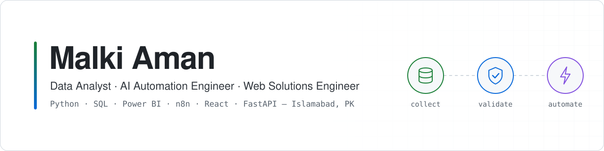

<picture>
  <source media="(prefers-color-scheme: dark)" srcset="./assets/banner-dark.svg">
  <source media="(prefers-color-scheme: light)" srcset="./assets/banner-light.svg">
  
</picture>

  
  

<h3 align="center">I build the systems that make data trustworthy and work effortless.</h3>

  Hi, I'm Malki, a data analyst and automation engineer from Pakistan and a Gold Medalist in Computer Science.
  Over the past two years I've built data quality pipelines for World Bank-funded surveys, AI workflows that save teams hours every week,
  and web apps that put machine learning in front of real users. I also teach Power BI and data analytics, so I'm used to making complex work easy to understand.

 

## What I bring

**Data you can rely on.** I design validation pipelines, error logs and QA reporting for large field surveys, so problems get caught in hours instead of days.

**Automation that pays for itself.** With Python, n8n and LLM APIs, I turn slow, repetitive processes into workflows that run on their own.

**Dashboards people actually use.** I build Power BI reports with DAX and Power Query that give managers a clear, live view of performance and quality.

**Products, not just prototypes.** I take machine learning models all the way to working apps with FastAPI, Flask and React, deployed and ready to use.

 

## Experience

**Data Quality Analyst** · Alliance of Excellence, Islamabad
 Dec 2025 to Present
 Built Python validation pipelines across 6 survey modules for a World Bank-funded programme, cutting manual QA effort by about 65%. Moved validation rules into YAML configs, so updates that once took days now take minutes, and built Power BI dashboards that track field performance and data quality in real time.

**Automation & Web Solutions Engineer** · Zama Technology, Islamabad
 Jan 2026 to Present
 Delivered 5+ automation systems, dashboards and web solutions for clients in Pakistan and abroad, including an AI healthcare app, an AI lead generation system and 5+ corporate websites built with React, WordPress and WooCommerce.

**Data Analyst** · GSpec Technologies, Lahore
 Nov 2025 to Jul 2026
 Ran data extraction and verification across 5+ sources at over 98% accuracy, automated 7+ recurring workflows to halve processing time, and built an AI chatbot and n8n automations that saved the team more than 15 hours a week.

<b>Teaching and training</b>

 

**Business Intelligence Instructor** · Global Ecom Hub, Swabi · Jun 2026 to Sep 2026
 Taught BI and dashboard development under a KPITB and IMSciences training initiative, and mentored students through real business projects.

**Data Analytics Trainer** · Human Care Foundation, Swabi · Aug 2026 to Sep 2026
 Led hands-on training in Excel, Power Query and Power BI, from raw data preparation to interactive dashboards.

**Web Development Trainer** · Digital Empowerment Network, Swabi · Mar 2024 to Apr 2024
 Guided students through building websites and setting up freelance careers on Fiverr.

 

## Featured work

### Urine Hydration & Kidney Stone Risk Detection
An AI healthcare app that reads a photo of a urine sample and estimates hydration status and kidney stone risk. OpenCV extracts colour features, a scikit-learn model classifies them, and a FastAPI backend serves the results to a clean React interface.

`React` · `FastAPI` · `OpenCV` · `scikit-learn` · `Tailwind CSS`

### Crop Yield Prediction System
A machine learning web app that predicts crop yield for any province or district in Pakistan from rainfall, temperature, pesticide use and planted area. It validates every input, preprocesses data automatically and produces a downloadable PDF report.

`Python` · `Flask` · `scikit-learn` · `pandas` · `ReportLab`

### Email Automation Ecosystem
A family of Python tools for high-volume outreach. A desktop sender rotates across accounts and resumes interrupted campaigns, a bounce analyser spots fully blocked batches, a bounce cleaner separates real failures from out-of-office replies, and an inbox cleaner keeps every account tidy.

`Python` · `SMTP` · `IMAP` · `pandas` · `PyQt6`

### Web Scraping Toolkit
Five production scrapers for lead generation and market research, with duplicate prevention, live CSV saving and authenticated, multi-source extraction.

[Google Maps](https://github.com/malkiaman-dev/GoogleMapDataExtractor) · [Y Combinator leads](https://github.com/malkiaman-dev/Y-Combinator-Lead-Scraper) · [ACBAR jobs](https://github.com/malkiaman-dev/ACBAR-Jobs-Scraper-App) · [AFR property](https://github.com/malkiaman-dev/AFR.com_Property-Scraper) · [Website email extractor](https://github.com/malkiaman-dev/Websit_url_to_email)

`Python` · `Selenium` · `BeautifulSoup` · `Requests` · `FastAPI`

<b>More projects</b>

 

**[Customer Feedback Chatbot](https://github.com/malkiaman-dev/customer-feedback-chatbot)**: an FAQ assistant with retrieval, source references and Gemini integration, built on Streamlit and covered by tests.

**[PIDC Workplan Maker](https://github.com/malkiaman-dev/PIDC_Workplan_Maker)**: a browser tool that plans field survey schedules around staffing, training, buffer days and Pakistan's public holidays, with CSV and Word export.

**[TechTide Studio](https://github.com/malkiaman-dev/TechTideStudio)**: an animated agency website built with React, Vite, Tailwind CSS, Framer Motion and GSAP.

 

## Tech stack

**Data & BI**
 

**AI, ML & automation**
 

**Web & backend**
 

**Tools & deployment**
 

 

## Education & recognition

**BS Computer Science, Gold Medalist** · University of Swabi, 2025

**First Runner-Up, Climate Theme** · IEEEP Fair 2024, Karachi Expo Centre
 Presented a solution for transforming plastic waste, judged on feasibility, environmental impact and scalability.

**Entrepreneurship programmes** · The Catalyst GIKI Incubator (2024) and Net Zero Challenge, National Incubation Centre Peshawar (2023 to 2024)

**Certifications** · HTML5, CSS3 and JavaScript for Web Developers, Johns Hopkins University (Coursera) · Certificate in IT, Web Software and Mobile Web Development (NAVTTC) · Information Representation and Data Organization (Huawei Talent Online)

 

## Let's work together

I enjoy talking about data, automation and web projects. The quickest way to reach me is **[mail.malkiaman@gmail.com](mailto:mail.malkiaman@gmail.com)**, or you can browse all of my work in my [repositories](https://github.com/malkiaman-dev?tab=repositories).
